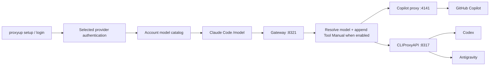

# harness-bridge

A local gateway that lets Claude Code choose models from **Copilot, Codex and AGY (Antigravity)** through one `/model` list. The CLI is called `proxyup`.

For non-Anthropic models, harness-bridge also supplies a **Tool Manual** explaining the Claude Code tools actually present in each request: what they do, when to use them, how to form arguments and how to interpret results. The aim is to help another model work with the existing harness, without replacing Claude Code or removing its tools.

**Early alpha.** Provider authentication is delegated to external adapters. The Tool Manual has been implemented but has not been runtime-tested; it is not a guarantee of equivalent tool performance across models. Real account login and full Claude Code sessions remain manual release checks. No credentials or third-party proxy binaries are included.



## Quick start from source

Requirements: **Node.js 22+**, Git, Claude Code, and the backend executable(s) for the providers you select.

```sh
git clone https://github.com/Phatitee/harness-bridge.git
cd harness-bridge

# Run without changing your existing proxyup installation:
node bin/proxyup.mjs --help
node bin/proxyup.mjs setup --providers copilot
node bin/proxyup.mjs start
```

Keep the gateway terminal open. In another terminal:

```sh
node bin/proxyup.mjs run
```

Inside Claude Code, type `/model`. The list is generated from the current catalog and labeled `[copilot]`, `[codex]` and `[agy]`. It is a flat list; this project does not patch Claude Code to add a nested provider menu. Start a new Claude Code session to rebuild the picker after an account/catalog change.

Claude Code must support gateway model discovery and the custom `modelPicker` settings used here. The inspected local build was `2.1.300` and contains both features; a complete interactive session on a clean installation remains a manual release check. If your build does not expose the custom picker, use an explicit `proxyup run --model <id>` and verify gateway support before expecting `/model` discovery.

The core has no production npm dependencies or build step. Install the selected provider adapters separately as described below before setup.

To install the `proxyup` command globally from this checkout, use `npm link`. **If you already use another `proxyup`, keep using `node bin/proxyup.mjs` until you deliberately switch installations.** Source is available in this repository; an npm package release has not been published.

## Tool Manual: teaching models the harness tools

The gateway builds guidance from `tools` in the current request and appends it to the existing system prompt before forwarding. A change in the request's tools or selected model is reflected on that next request. The guide is supplementary text: the full original schemas continue to define valid calls.

| What the model learns | Where it comes from |
| --- | --- |
| Which tools are visible now | Exact tool names supplied by Claude Code, including MCP definitions |
| When to choose a tool | Original guidance for recognized native tools and the live description for other tools |
| How to supply inputs | Actual required fields, property/type summaries and simple illustrative arguments |
| What to do with results | Guidance for completed calls, errors, truncation and running/background work |

The guide does not guess tools missing from the request. Complex/ref-dependent schemas receive no invented argument example; deferred tools are identified as needing discovery/loading. Descriptions and field summaries are compact, while every original definition remains intact. No extra model call is used to generate the guide.

Add or edit this field in your installation's `config.json`, preserving its other settings:

```json
{
  "toolManual": {
    "mode": "non-anthropic"
  }
}
```

| Mode | Effect |
| --- | --- |
| `non-anthropic` | Default, also used when the field is absent. Attach guidance for resolved upstream IDs that do not look like Anthropic Claude models. |
| `all` | Attach guidance for every model with named tools, including custom model naming schemes. |
| `off` | Forward without adding the manual. |

Restart this repository's gateway after code/config changes. It preserves existing prompt blocks, tool schemas and permissions. Tools are still executed by Claude Code/MCP on your machine. No separate `/toolist` command, permanent per-session tool inventory or model fine-tuning is installed.

The guide adds prompt tokens and cannot fix a rejected schema, unsupported tool protocol or a model without function calling. See the [Tool Manual reference](docs/tool-manual.md), [source research](docs/research/claude-code-tools.md) and [rules design](docs/tool-rules-design.md) for the implementation boundaries.

## Provider dependencies and login

Install the appropriate adapters yourself before setup:

| Provider | Executable | Auth delegated to |
| --- | --- | --- |
| Copilot | `copilot-proxy-api` | GitHub device authorization |
| Codex | `cliproxyapi` | Codex OAuth or device authorization |
| AGY | `cliproxyapi` | Antigravity OAuth |

Reference projects: [Copilot proxy](https://github.com/voidsteed/copilot-proxy-api), [CLIProxyAPI](https://github.com/router-for-me/CLIProxyAPI). These are separate projects with their own releases, licenses and provider requirements. Do not assume the APIs are official provider APIs.

```sh
proxyup setup --providers copilot,codex,agy
# Or add/login individually:
proxyup login copilot
proxyup login codex --device
proxyup login agy --no-browser
```

Setup logs in selected providers, temporarily starts their managed backends to validate the catalog, and asks for a default model. All inputs also have explicit flags for non-interactive operation:

```sh
proxyup setup --providers codex --no-login
proxyup login codex --device
# Terminal 1:
proxyup start
# Terminal 2:
proxyup models codex --json
proxyup run --model codex/claude-route-YOUR_ADVERTISED_MODEL_ID
```

`--no-login` only creates configuration; it does not certify account access. Login success is reported as `authenticated-awaiting-validation`; a provider is `ready` only after its model endpoint succeeds. Browser/device login requires the account owner. Runtime model requests never initiate login.

### Existing proxies / port conflicts

Managed mode refuses occupied backend ports. It does not kill or adopt your existing proxies. To reuse running instances:

```sh
proxyup setup --providers copilot,codex,agy --attach --no-login
export COPILOT_API_KEY='your-existing-local-proxy-key'
export CLIPROXY_API_KEY='your-existing-local-proxy-key'
proxyup start
```

These environment variables contain **local proxy keys**, not provider OAuth tokens. Leave a variable unset if that attached local backend has no API-key authentication. Attached CLIProxy authentication stays with that external installation; `proxyup login` does not replace its credentials. Set another gateway port in config if `8321` is already occupied.

## Claude Code integration

`proxyup run` launches Claude Code with a private temporary settings file and generated picker. It leaves user permissions, MCP configuration and global Claude settings alone. Internal Opus/Sonnet/Haiku aliases initially point to the startup route so child calls do not leak an unsupported bare model ID upstream. Aliases remain the startup default when you switch the main model during the session.

```sh
proxyup run --provider copilot
proxyup run --model codex/claude-route-YOUR_ADVERTISED_MODEL_ID
proxyup integrate
# Then, with ~/.local/bin on PATH:
claude-gateway
# Remove only our launcher:
proxyup integrate --remove
```

The optional launcher is `claude-gateway`, not a replacement for your `claude` binary. Re-run integration after moving the checkout. Bare `claude` keeps its pre-existing configuration. Additional Claude CLI flags are not forwarded in this alpha; unknown flags fail rather than being ignored.

## Configuration and credentials

Config defaults to `$XDG_CONFIG_HOME/proxyup` or `~/.config/proxyup`. Set `PROXYUP_HOME` for an isolated installation. The CLI is independent of your current directory and does not embed personal absolute paths.

- `config.json`: providers, mode (`managed` or `attach`), binary names, local URLs, default model.
- `secrets.json`: generated local gateway/backend keys, file mode `0600`.
- `cliproxy.yaml`: generated backend config; CLIProxy credential files stay under `credentials/cliproxy` in this installation.
- `logs/`: private backend logs for foreground managed processes. No automatic upload or telemetry. Rotation is not implemented yet; inspect disk usage for long-running sessions.

Copilot authentication is owned by its adapter and uses that adapter's existing user-level token store. Two installations share that Copilot account. The local Copilot backend key is passed using the adapter's `--api-key` argument; users with access to the process table can see that local key. Provider OAuth tokens are not passed in process arguments or written to Claude settings. Backend bind behavior is controlled by the external adapter; the gateway itself binds only to `127.0.0.1`.

`proxyup logout <provider>` **disconnects the provider from this config and clears its saved default**. It intentionally retains external credentials and does not revoke the account. Restart the gateway after login/logout/config changes. No running session is silently moved to another account.

CLIProxy model ownership must be identifiable from metadata (`provider` / `owned_by`). Unknown shared models are excluded instead of guessed. Assign otherwise ambiguous upstream IDs explicitly in `config.json`:

```json
{
  "modelIds": ["upstream-model-id"]
}
```

This object belongs in `providers.codex` or `providers.agy`; keep the other provider fields. Do not assign the same ID to both. There is no AGY CLI dependency and no fabricated effort variant absent from the upstream catalog.

## Operations

```sh
proxyup status --json
proxyup doctor
proxyup accounts
proxyup models --refresh
proxyup logout agy
```

`proxyup` / `proxyup start` runs in the foreground. Ctrl-C stops the gateway and only the child backends it started. Attached proxies keep running. Backend startup is bounded and logs go to the private paths printed on stderr. There is no background daemon, remote shutdown command, service installer or split-pane dashboard in this alpha.

CLI data defaults to compact TOON-style objects/tables; use `--json` for machine integration. Progress goes to stderr. Exit codes: `0` success, `1` runtime failure, `2` invalid usage. Every subcommand accepts `--help`; invalid flags are rejected before writes/login.

## Tools and current limits

The gateway preserves tool schemas, tool results and streams for the protocol adapters to translate. It never executes local tools itself and does not silently remove them. Tool execution stays in Claude Code/MCP with its existing permissions.

Catalog inclusion is **not** tool certification: every model currently has `capability: unknown`. This alpha does not promise that all models support every Claude Code feature or fix all Gemini schema incompatibilities. Schema adaptation, tool round-trip probes and an interactive toolist selector are separate planned work. The Tool Manual feature has not been runtime-tested; previously recorded suite results predate it.

Other boundaries: one active account per provider; no automatic adapter installation/version upgrades; no refresh-in-place of an already running gateway after login; no account-drain coordinator; no Windows launcher or service integration yet. Config writes assume one setup/login process at a time.

## Development

```sh
npm test
npm run check
npm pack --dry-run
```

No production npm dependencies. Tests use synthetic catalog/auth/protocol fixtures and private temporary directories, never your account. The HTTP listener test skips only when the execution environment forbids loopback binding. CI runs Linux/macOS on Node 22/24; account login is a separate manual release check.

See [architecture](docs/architecture.md), [adapter compatibility](docs/adapters.md), [CONTRIBUTING](CONTRIBUTING.md) and [SECURITY](SECURITY.md). Original code is MIT licensed. Dependency licenses are governed by their upstream projects; third-party code/binaries are not bundled.
