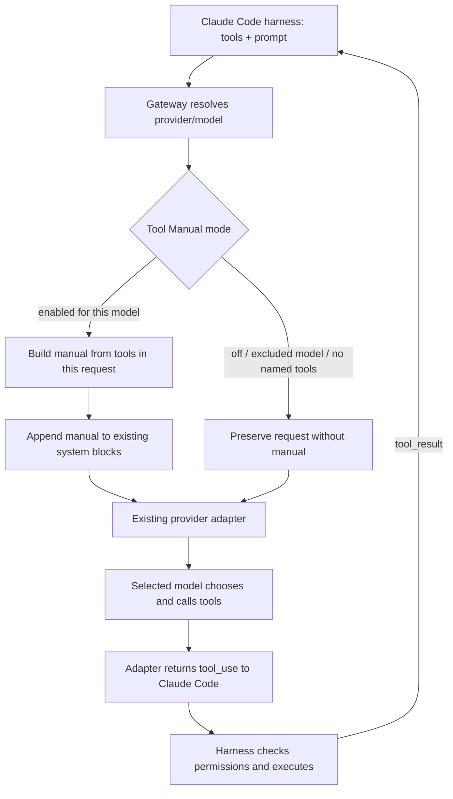

# Tool Manual for other provider models

harness-bridge now adds tool guidance to requests for non-Anthropic models by default. This is guidance, not model training or a guarantee of tool-calling capability. It does not install extra tools, change permissions, execute tools or remove any tool definitions.

## Request flow



The manual is built at request time, so the next request reflects model switches and the definitions the harness currently sends. No additional provider call or model-generated documentation is required. The same enrichment applies to Messages and count-tokens requests for consistent token accounting. Adapter token-count support still depends on that adapter.

## What the model receives

1. A short core explaining how to choose tools, make structured calls, read results and follow continuations.
2. A card for **each named definition in this request**. Every card keeps the exact name and quotes a compact excerpt of the live description.
3. Input guidance: actual required fields, a compact property/type summary and the unchanged full schema in the original `tools` array.
4. Purpose/result explanations for recognized Claude Code tools. MCP tools use their live server-qualified name and description; unknown names get schema-driven guidance rather than fabricated behavior.
5. Illustrative arguments where a simple schema can be handled conservatively. Complex references, formats and constrained schemas get no guessed example. Example paths/text/IDs are placeholders, not discovered workspace data or completed calls.

Description excerpts and field summaries are intentionally concise. All original tools, descriptions, schemas, optional fields and results remain in the original payload. The manual does not substitute its shorter summaries for any tool contract.

No tool is added merely because it appears in a guide. In particular, the module does not assume historical tools like TaskOutput exist in the current session. Deferred definitions are marked as deferred, and no automatic enabling of ToolSearch is attempted. Named tools omitted entirely by the harness cannot be reconstructed by the gateway.

## Configure

Optional `config.json` setting:

```json
{
  "toolManual": {
    "mode": "non-anthropic"
  }
}
```

| Mode | Behavior |
| --- | --- |
| `non-anthropic` | Default, including existing configs without this field. Attach for models whose resolved upstream ID does not look like an Anthropic Claude model. |
| `all` | Attach for every selected model with named tool definitions. Useful when a custom upstream ID cannot be classified by name. |
| `off` | Send the original system prompt without adding guidance. |

Provider namespace alone does not determine model family: Copilot can serve Claude as well as other model families. Detection uses the resolved upstream model ID; it is a heuristic, so choose `all` or `off` for custom naming schemes.

Restart this repository's gateway after code/config changes. Existing system prompt strings or content blocks are preserved and the generated text is appended as another system text block. Existing cache-control fields are retained; this feature does not claim provider-side prompt caching. Re-enriching a payload replaces this module's previous marked block instead of multiplying copies.

## Privacy, cost and scope

The generator uses tool definitions only, not conversation content, tool arguments/results or account credentials. It makes no network calls and does not persist a runtime tool inventory. Definitions already present in the request are being described to the same model, not exported elsewhere.

The appended text adds prompt tokens; there is no claim of zero overhead or universal performance improvement. A request that exceeds the gateway's 16 MiB limit after enrichment is rejected with an explanation; tools are never silently removed to shrink it. Set mode to off when comparing behavior or when context budget is more important.

This implementation intentionally appends at the gateway boundary rather than replacing the harness system prompt or requiring a new Claude CLI prompt flag. Child-agent requests receive the guide only if those requests also pass through this gateway and include tool definitions. It does not change child-agent routing or invent inherited tools.

Schema/protocol incompatibilities, missing tools, permissions and model function-calling limitations remain separate concerns. The manual cannot fix those by instruction alone.

## Implementation and verification status

- `src/tool-manual.mjs`: original explanation cards, conservative argument illustrations and immutable prompt enrichment.
- `src/gateway.mjs`: apply enrichment after route resolution and before forwarding.
- `src/config.mjs`: default mode and configuration validation.

The user explicitly requested no tests for this work. No test suite, live login or model request was run for this feature. Syntax/diff inspection is separate from runtime validation and does not establish real-provider compatibility.

For the upstream evidence behind this design, see [research notes](research/claude-code-tools.md) and the [rules draft](tool-rules-design.md). The executable guidance is focused on understanding tools, not a wholesale new policy for the assistant.
